# VTherm Config Panel

A full-page configuration UI for [Versatile Thermostat](https://github.com/jmcollin78/versatile_thermostat),
instead of its step-by-step config flow. One sidebar entry, all your VTherms on top, every
setting of the selected one on a single page.

Proof of concept for the discussion in
[versatile_thermostat#2171](https://github.com/jmcollin78/versatile_thermostat/issues/2171).
It does not change Versatile Thermostat: it saves through VT's own config flow.

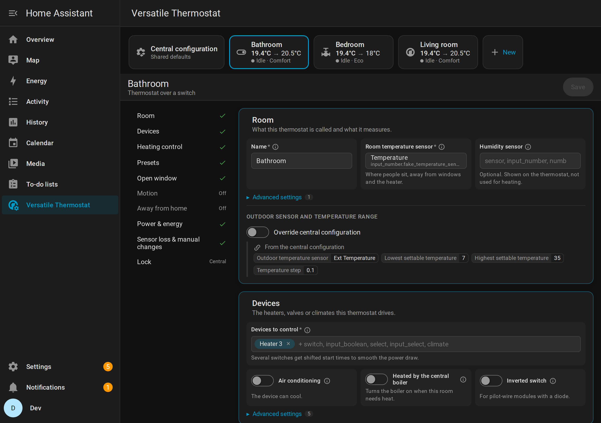

## What it does

- **All thermostats on one page.** Tiles on top show each VTherm's live temperature, target,
  what it is doing and its preset; the central configuration is the first tile.
- **Settings grouped by what you set up**, not by flow step: Room, Devices, Heating control,
  Presets, Open window, Motion, Away from home, Power & energy, Sensor loss & manual changes,
  Lock. Features are switched on in their own card; rarely needed settings sit in a collapsed
  "Advanced settings" inside the card they belong to.
- **Central configuration made visible.** Every group that can inherit from the central
  configuration has an "Override central configuration" toggle; inherited values stay visible,
  read-only, with where they come from.
- **Explained settings.** Short labels, a hint under each field and an (i) with the longer
  explanation, some with a small diagram. Texts in English and French; other languages use
  Versatile Thermostat's own strings.
- **Preset temperatures on the page**, editable where they live (the thermostat or the central
  configuration).
- **New thermostats** start from a type chooser that explains the three kinds of VTherm.
- A **"Visit" link** on each VTherm's device page opens its configuration here.

| | |
|---|---|
| 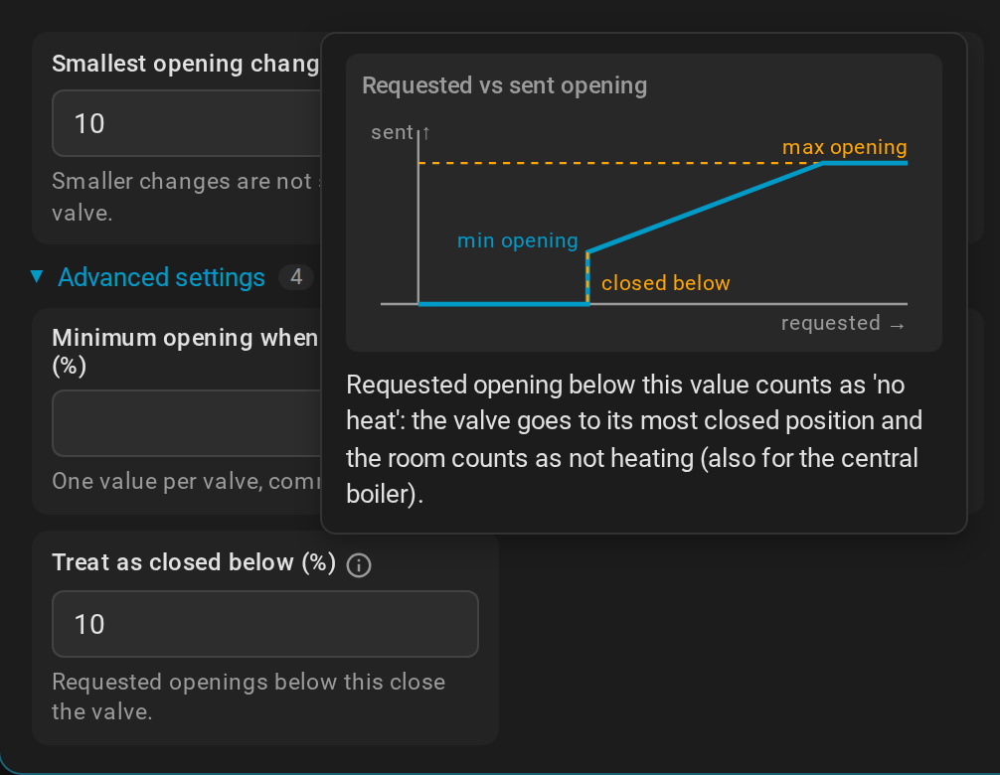 | 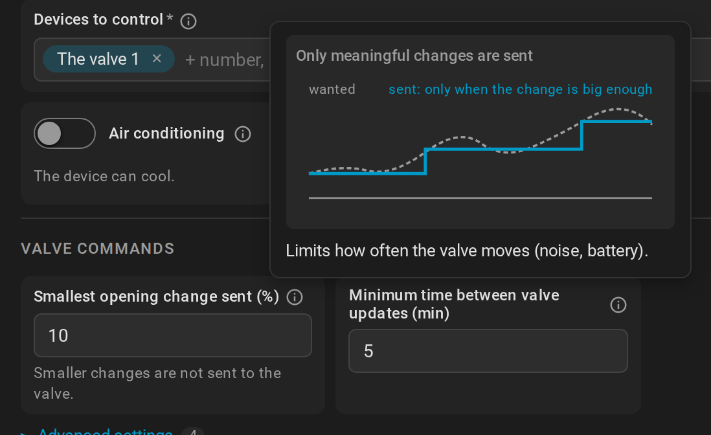 |
| 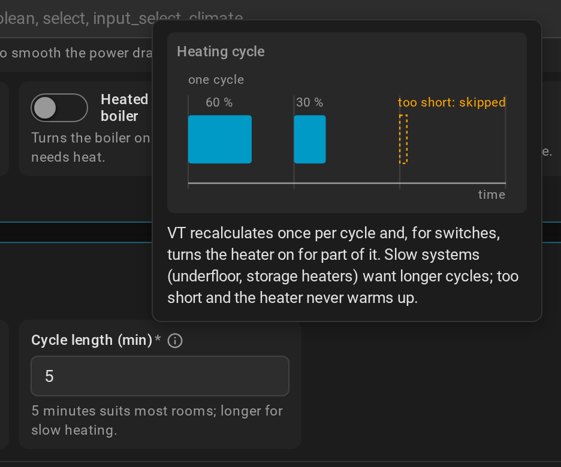 | 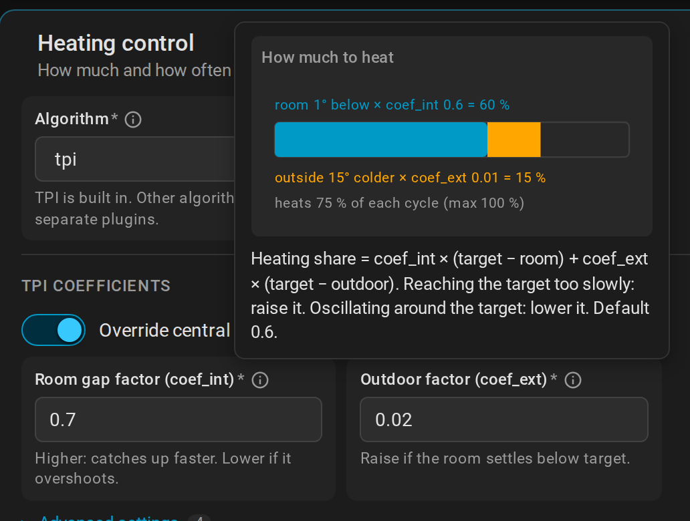 |
| 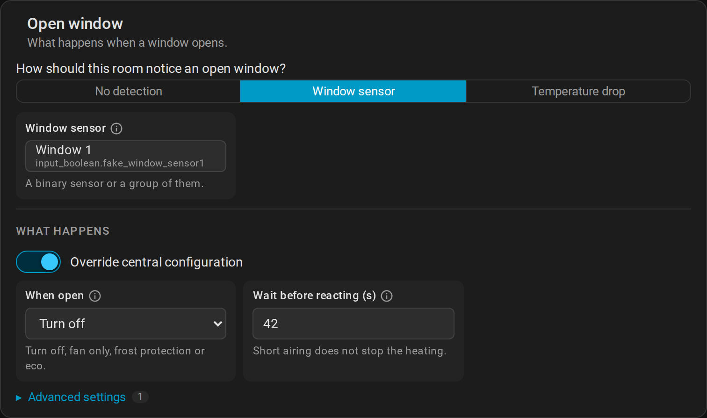 | 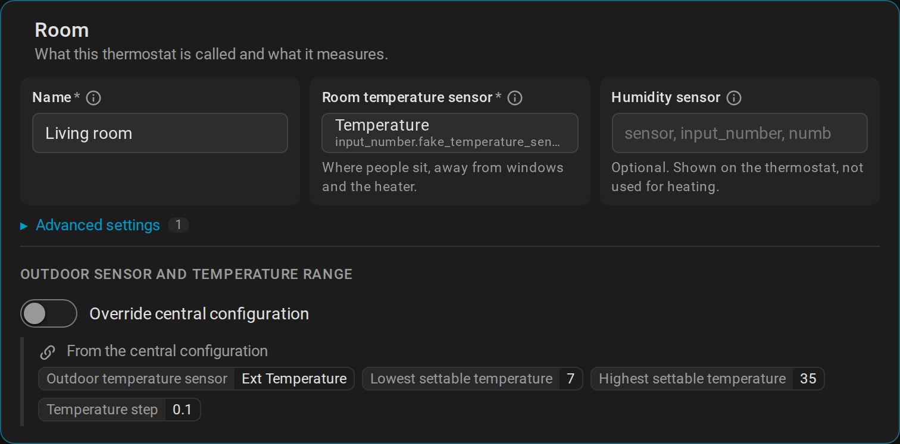 |
| 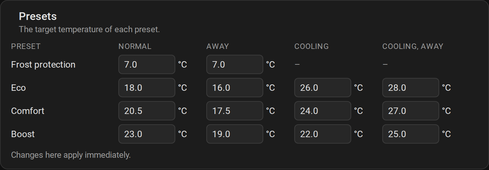 | 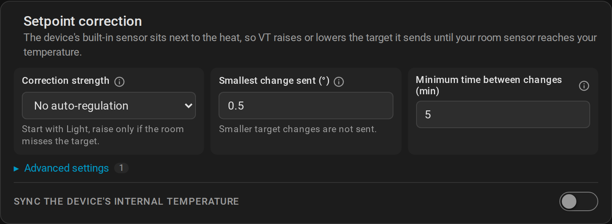 |
| 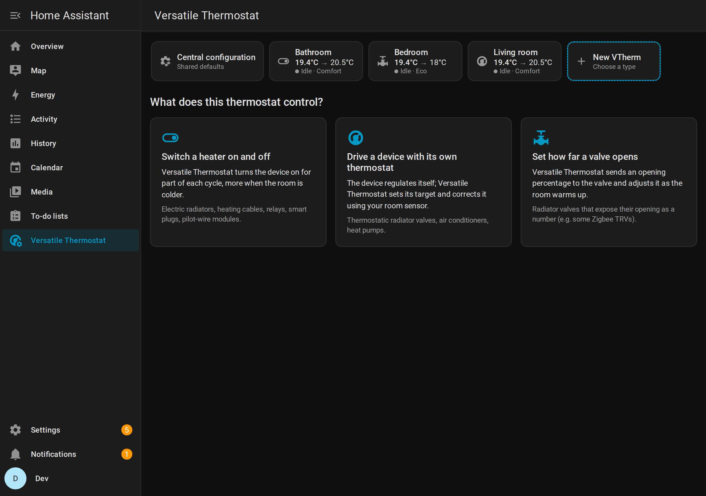 | 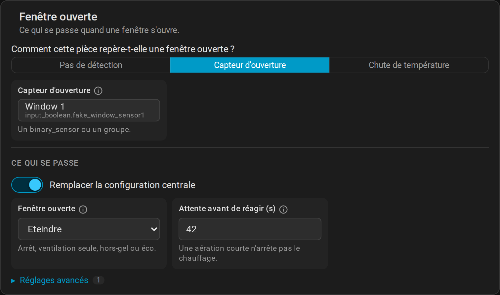 |

## Install

Requires Versatile Thermostat (tested with 10.6.3) and Home Assistant 2026.3 or newer.

1. HACS → ⋮ → Custom repositories → `https://github.com/Liquidmasl/vtherm_config_panel`, type
   *Integration*.
2. Install **VTherm Config Panel**, restart Home Assistant.
3. Settings → Devices & services → Add integration → **VTherm Config Panel**.

"Versatile Thermostat" then appears in the sidebar (admins only).

## How it works

The panel never writes Versatile Thermostat's configuration itself. On save it walks VT's own
options flow (or config flow, for a new thermostat) in-process and answers each form with your
values, so VT's validation, cleanup and reload run exactly as when you click through the flow.

```
panel (Lit) ──websocket──► vtherm_config_panel
                             ├ sections.py     which fields VT shows for this config (mirrors VT's menu)
                             ├ layout.py       which card, group and level each field goes into
                             ├ flow_driver.py  save = walk VT's config/options flow
                             └ device_links.py "Visit" link on VTherm devices
```

Known limits:

- `sections.py` mirrors VT's menu routing. If VT adds or reshuffles steps, it must follow;
  settings VT adds later appear in an "Other" card until placed.
- A save stops at the first section VT rejects, so errors show one section at a time.
- HA's lazy-loaded frontend elements are loaded by borrowing HA's config panel
  (`load-ha-elements.ts`), which is not an official frontend API.

## Development

```bash
npm install
npm run build                                          # or: npm run watch
cd dev && docker compose up -d && python3 onboard.py   # HA on :8124, user dev/dev
node dev/e2e/create-edit.mjs                           # end-to-end: create, edit, save, clean up
node dev/e2e/screenshots.mjs                           # regenerate docs/images
```

The dev instance mounts Versatile Thermostat from `../versatile_thermostat` (override with
`VT_REPO`) and uses VT's own devcontainer configuration with fake sensors and heaters.
